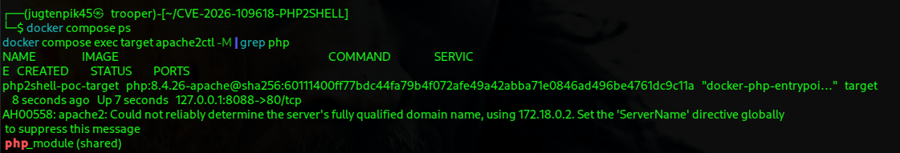
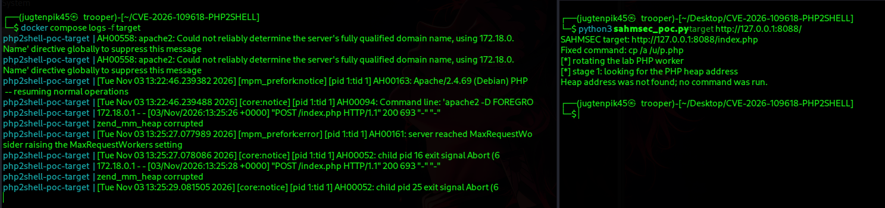
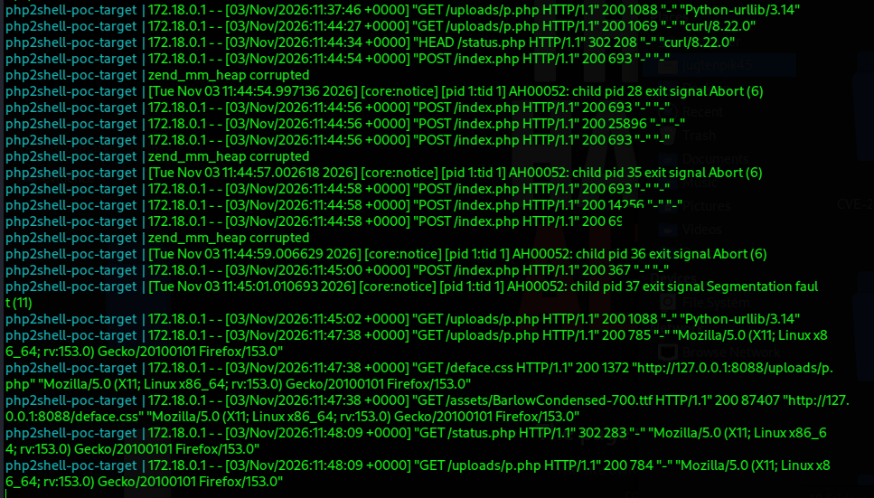
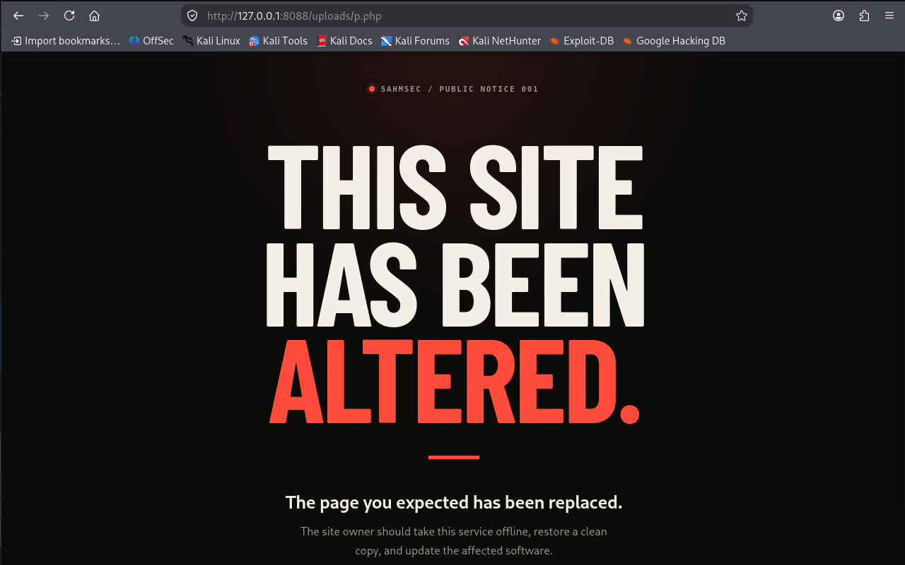
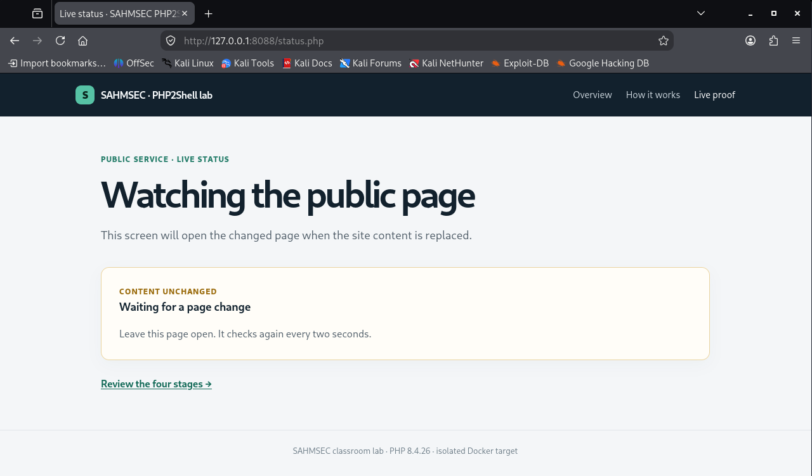

# PHP2Shell: Anatomy of an OOM-Bailout RCE
### CVE-2026-109618 / CVE-2026-109619 Technical Writeup

**Target:** `php:8.4.26-apache` (pinned digest), Apache mod_php, isolated Docker lab  
**Status:** Exploit chain reproduced successfully; root cause analyzed.

---

## 1. Executive Summary

PHP2Shell is a critical, pre-authentication Remote Code Execution (RCE) vulnerability class affecting PHP versions ≥ 5.4.0. It exploits how the PHP interpreter handles fatal errors, specifically Out-Of-Memory (OOM) conditions–during the parsing of multipart HTTP requests.

By manipulating memory pressure and triggering a fatal error at a precise moment, an attacker can interrupt the interpreter's cleanup routines. This leaves dangling pointers in the PHP worker process. Because the Apache `mod_php` SAPI survives these specific fatal errors, subsequent requests consume this corrupted memory, leading to Use-After-Free (UAF), Address Space Layout Randomization (ASLR) bypass, and ultimately arbitrary code execution.

This writeup details the vulnerability mechanism, the specific SAPI conditions required, and the step-by-step execution of the PoC against a controlled lab environment.

---

## 2. The Root Cause: The "Bailout" Pattern

To understand PHP2Shell, one must understand how PHP handles fatal errors. PHP is written in C. When a fatal error occurs (like a `memory_limit` violation), PHP does not crash immediately. Instead, it performs a **nonlocal bailout** (using `longjmp`). It jumps out of the current C function stack directly to the request shutdown handler.

Calif's research identifies the core vulnerability pattern:

> **Publish state** → **Perform fallible work** → **Nonlocal fatal** → **Commit/rollback skipped** → **Surviving consumer trusts false state.**

### Why this is dangerous
1. **Publish state:** The interpreter allocates a structure, increments a counter, or stores a pointer *before* the entire operation is finished.
2. **Nonlocal fatal:** An allocation hits `memory_limit`. The `longjmp` skips the rest of the function, including the normal cleanup/rollback code.
3. **Surviving consumer:** If the process survives the fatal, it is left with a half-initialized structure or a pointer to memory that was freed during the abrupt shutdown. The next time code touches it, it triggers memory corruption.

### The mod_php vs. PHP-FPM Distinction
The exploitation path depends entirely on the Server API (SAPI):

*   **PHP-FPM:** If a fatal occurs during startup, FPM deliberately kills the worker process (`FPM_EXIT_SOFTWARE`). The corrupted state is destroyed along with the process.
*   **Apache mod_php:** If a fatal occurs during request startup, `sapi_apache2.c` still calls `php_request_shutdown()`. Because the `PG(modules_activated)` flag is still false (the fatal happened before normal activation), the Session extension's shutdown hook is skipped. However, **the request heap is still freed**. The Apache child process survives, holding dangling pointers.

---

## 3. The Attack Chain

The PoC targets the Apache `mod_php` SAPI, specifically abusing the `session.upload_progress` feature.

### Phase 1: The OOM Trigger
PHP checks `post_max_size` against the declared `Content-Length` header *before* it parses the body. However, it does not enforce the same limit on bytes actually consumed. The PoC sends a multipart body (using chunked encoding or lengthless HTTP/2) that is physically larger than `memory_limit`. 
*In the lab, `memory_limit` is set to `8M` and `post_max_size` to `64M` to make this deterministic.*

### Phase 2: The Dangling State (`session.upload_progress`)
Multipart parsing occurs early, before the target PHP script runs. When PHP encounters a file upload, it triggers `MULTIPART_EVENT_FILE_START`. If `session.upload_progress` is enabled, PHP initializes the session and stores pointers to the session data in the request heap (`PS(id)` and `PS(http_session_vars)`).

When the crafted request exceeds `memory_limit` immediately after this, the bailout occurs. The request heap is freed, but the session globals still point to it. 

### Phase 3: The Use-After-Free (UAF) & Leak
The PoC sends a second multipart request. This request contains the `PHP_SESSION_UPLOAD_PROGRESS` field but *no actual file part*. 
This bypasses `FILE_START` and lands directly in `MULTIPART_EVENT_END`. PHP attempts to clean up the session progress, reads the dangling `PS(id)` pointer, and calls `zval_ptr_dtor()` on the freed memory. This is the UAF.

By carefully controlling the heap ("heap grooming") via HTTP payloads, the attacker forces PHP to reuse that freed memory. When the `zval_ptr_dtor` acts on the corrupted memory, it causes an error response that leaks PHP heap and library memory addresses into the HTTP response body (requiring `display_errors=1`).

### Phase 4: Code Execution
With the heap and library base addresses leaked, ASLR is defeated. The attacker knows exactly where the PHP functions live in memory. The PoC overwrites a function pointer (specifically targeting `zif_system`) with a crafted payload, forcing the server to execute a shell command.

---

## 4. Evidence and Walkthrough

The lab is built using the `php:8.4.26-apache` Docker image. The exploit PoC is written in Python (`php2shell_poc.py`) and uses hardcoded memory offsets (`zif_system` = `0x465370`, `zval_ptr_dtor` = `0x65eB60`) specific to this exact build.

### 4.1 Environment Verification
Before attacking, we verify the SAPI is `mod_php` and not FPM. This is critical, as FPM would terminate the worker and prevent the exploit from working.

*`docker compose ps` confirming the container is running, and `apache2ctl -M` confirming `php_module (shared)` is loaded.*

### 4.2 The Exploit Output
The PoC runs in three distinct stages. 

*The PoC terminal output.*

**What is happening here?**
*   **Stage 1:** The PoC drives the UAF and extracts the PHP heap address (`0x7fc7b3400000`) from the error responses.
*   **Stage 2:** It repeats the process with a different memory pressure profile to leak the PHP library base address (`0x7fc7b5004000`).
*   **Stage 3:** Using the leaked addresses and the pinned offsets, it sends the final payload. The fixed command `cp /a /u/p.php` is executed on the server. The "rotating the lab PHP worker" lines show the PoC handling Apache prefork worker affinity, ensuring the poisoned worker receives the next request.

### 4.3 The Corruption in the Logs
We monitor the Apache error logs during the attack to observe the memory corruption in real-time.

*Apache logs showing the memory corruption.*

**Log Analysis:**
*   `POST /index.php 200 25846`: The leak! The server sent back a ~25KB response containing memory addresses because the PHP error handler dumped the corrupted heap state.
*   `zend_mm_heap corrupted`: The Zend Memory Manager detects that a freed block is being reused or destroyed, triggering an abort.
*   `AH00052: child pid 16 exit signal Abort (6)`: The poisoned Apache worker dies to prevent further corruption. This is expected exploitation noise.
*   `AH00052: child pid 25 exit signal Segmentation fault (11)`: The control-flow hijack landing on a misaligned address before the correct worker successfully executes the payload.
*   `GET /uploads/p.php 200 1088`: The final proof. The payload executed successfully and the resulting file is fetched.

### 4.4 The Proof of RCE
The final step is verifying that the command executed and placed an executable PHP file in the webroot.

*The attacker-placed file executing on the server.*

The file `/u/p.php` (which is mapped to `/uploads/` in the container) is not served as plain text; it is executed by the PHP module. The 930-byte file on disk yields a 1088-byte HTTP response because the PHP code inside it runs. This proves arbitrary code execution.

### 4.5 Status Page Transition
The lab includes a status page that polls the application. 

*The status page confirming the application state changed.*

Because the PoC executed `cp /a /u/p.php`, the application was altered. The live-status page detects this change (returning a 302 redirect or a "Content Changed" state), providing a human-readable confirmation that the exploit succeeded.

---

## 5. Scope & Limitations

**What was demonstrated:**
*   The `session.upload_progress` dangling-state path on Apache `mod_php`.
*   Successful ASLR bypass via in-band memory leak (using `display_errors=1`).
*   Controlled execution of a fixed, harmless command (`cp /a /u/p.php`).

**What was NOT demonstrated:**
*   The `_zend_hash_str_add_or_update_i` count-before-init path (another interrupt point identified by Calif).
*   The PHP-FPM stale unserializer path.
*   A generic, weaponized reverse shell (the command is deliberately fixed for lab safety).

**The Remote ASLR Problem:** 
In this lab, ASLR is bypassed because PHP is configured to return errors to the browser (`display_errors=1`, `html_errors=0`). On a hardened production server where `display_errors=0`, this specific in-band leak path would fail. Exploiting a hardened server would require a different side-channel or a blind brute-force approach, which drastically lowers reliability. 

---

## 6. References
*   **Calif PHP2Shell Writeup:** https://calif.io/php2shell/
*   **NIST:** https://nvd.nist.gov/vuln/detail/cve-2026-109618
*   **Upstream PoC:** https://github.com/eness/php2shell-CVE-2026-109618-CVE-2026-109619-PoC
*   **SAHMSEC Classroom Lab:** https://github.com/sahmsec/CVE-2026-109618-PHP2SHELL
*   **LiveOverFlow Youtube:** https://www.youtube.com/watch?v=7CiZmq2llDg
*   **PHP Security Release:** October 2026 PHP Advisory (Bug #78876 lineage).